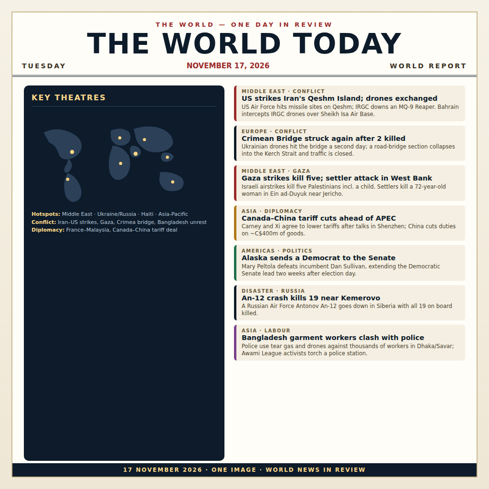

# The World Today — 17 November 2026

An entry for the make.fun competition `news-image-20261117`: sum up Tuesday, 17 November 2026’s world news in one image.



## Design

The 1024 × 1024 infographic takes its layout from a newspaper front page. A navy masthead and warm ivory background frame a two-column layout: a world map with gold location markers on the left, and seven color-coded headline cards on the right. The map gives readers geographic context while the cards carry the day’s headlines and short summaries.

## Stories covered

- U.S. strikes on Iran’s Qeshm Island and an exchange of drones.
- Another strike on the Crimean Bridge.
- Airstrikes in Gaza and a settler attack in the West Bank.
- Canada–China tariff talks ahead of APEC.
- Alaska’s U.S. Senate election result: a Democrat wins the seat.
- A Russian An-12 crash near Kemerovo.
- Protests by garment workers in Bangladesh.

## Run locally

Use Node.js 22. No packages or build step are required. From the repository root, run:

```sh
MAKEFUN_OUTPUT_DIR=./output node main.ts
```

This checks the source image’s eight-byte PNG signature, creates the output directory if needed, and copies the finished image to `./output/entry.png`. Without `MAKEFUN_OUTPUT_DIR`, the destination is `/output/entry.png`; the process needs permission to write there. The program copies the supplied image as-is rather than rendering it.

## License

MIT; see [LICENSE](LICENSE).
